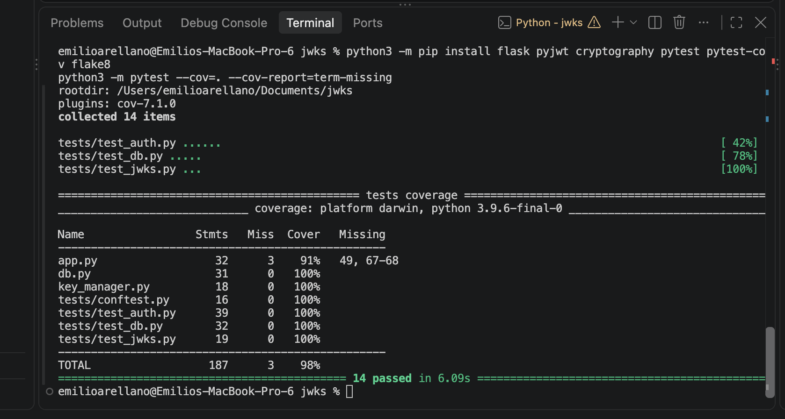
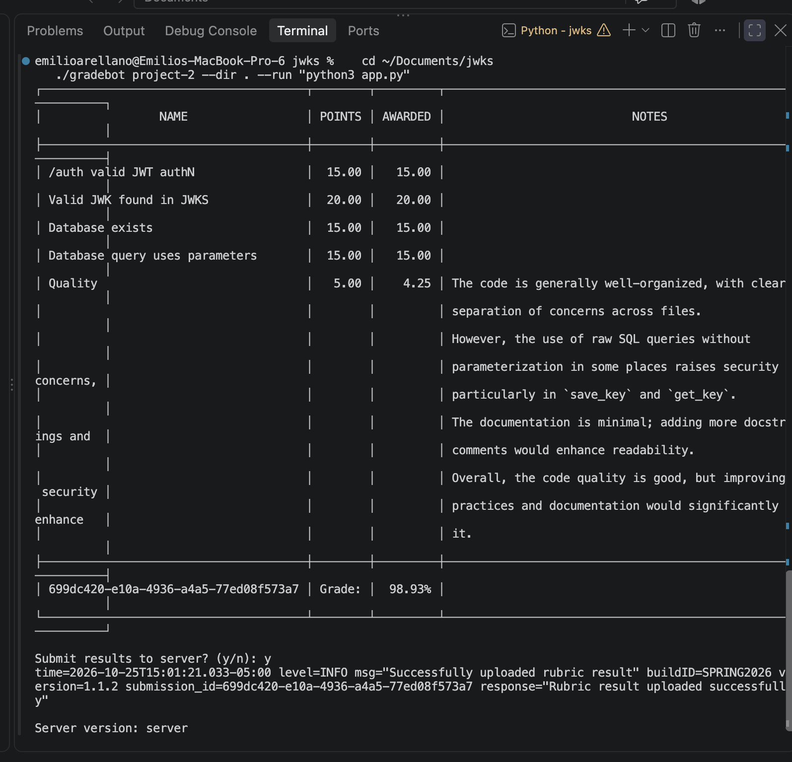

# JWKS Server (Project 2)

Emilio Arellano  
**Course:** CSCE 3550  
**Project:** SQLite-backed JWKS Server

## Overview

A RESTful JWKS server built with Python and Flask. RSA private keys are stored in a
SQLite database (`totally_not_my_privateKeys.db`) so they persist across restarts.
Keys are serialized to PKCS1 PEM before being saved and deserialized when read.

All SQL queries use `?` parameters, so values are never formatted into query
strings, which prevents SQL injection.

## Endpoints

- `POST /auth` signs and returns a JWT using a valid key from the database.
  With `?expired`, it signs with an expired key instead.
- `GET /.well-known/jwks.json` returns the public keys for all unexpired keys.

## Project Structure

- `app.py`: Flask routes
- `db.py`: SQLite schema and parameterized queries
- `key_manager.py`: RSA key generation, PEM serialization, seeding the DB
- `tests/`: pytest suite

## Setup and Running

```bash
pip install flask pyjwt cryptography pytest pytest-cov
python3 app.py
```

The server runs on port 8080 and creates the database on first start, with one
valid key and one expired key.

## Tests

```bash
python3 -m pytest --cov=. --cov-report=term-missing
```

Coverage: 98%

## Screenshots

### Test coverage


### Gradebot results

